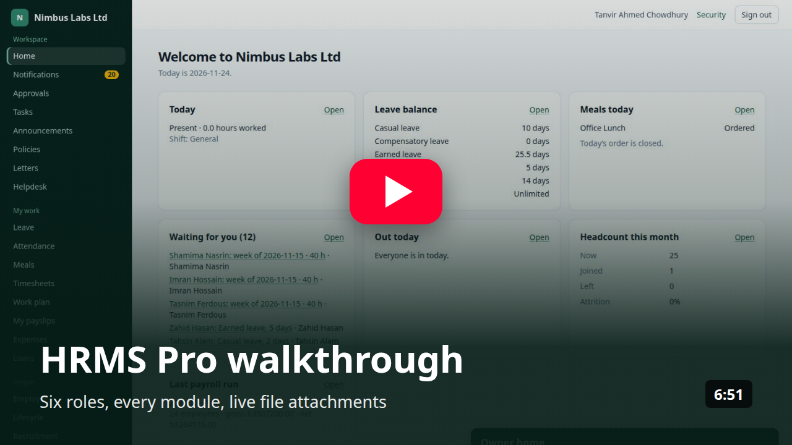
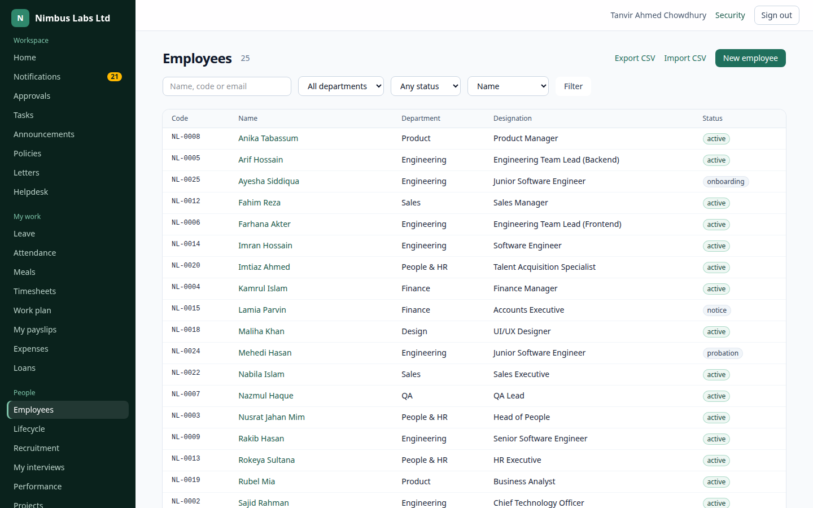
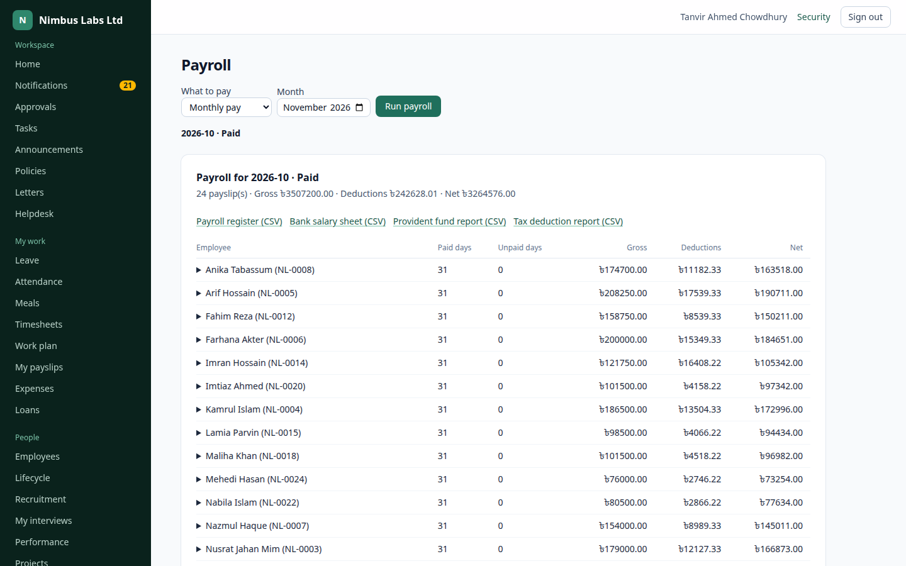
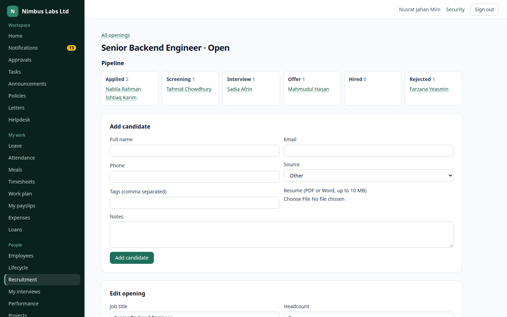
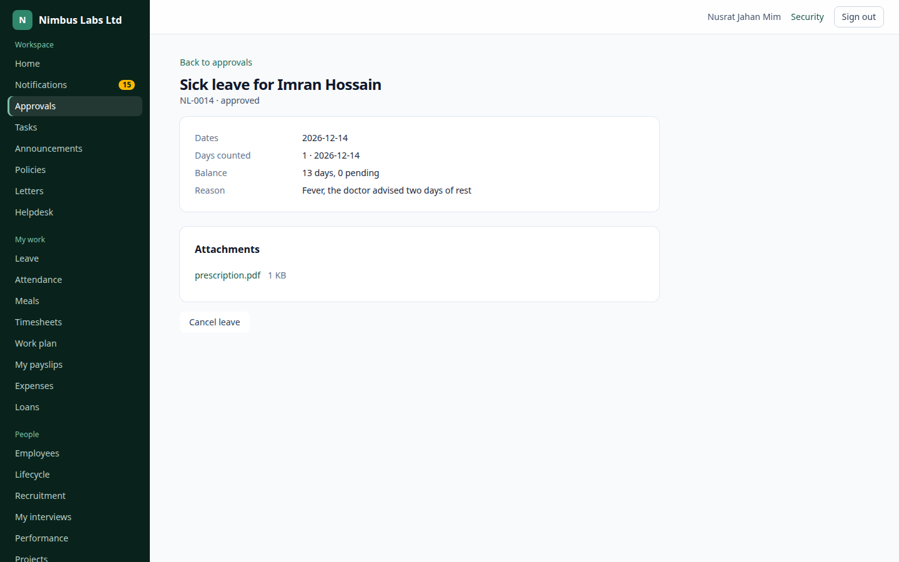

# HRMS Pro

Multi-tenant HR system for running a software company: people, directory and org chart, team calendar and
events, leave, attendance,
timesheets, payroll with Bangladesh tax, loans, expenses, meal billing, recruitment, performance, helpdesk, letters,
policies, shareable reports and one search box for pages and records.

SvelteKit (Svelte 5) · TypeScript · Postgres 17 with row-level security · drizzle-orm · Redis + BullMQ · MinIO ·
Vitest · Playwright · Docker.

[](https://youtu.be/BGxO0nnjlsM)

<p align="center"><a href="https://youtu.be/BGxO0nnjlsM" target="_blank" rel="noopener">▶ Watch the 7-minute walkthrough on YouTube</a></p>

<p align="center"><a href="https://srabon444.github.io/hrms-pro/"><b>System design</b></a>: architecture, data model, business requirements and functional spec</p>

## Screenshots

<table>
  <tr>
    <td width="50%"><br><sub>Dashboard scoped to the signed-in role</sub></td>
    <td width="50%"><br><sub>Employee directory with filters and CSV import and export</sub></td>
  </tr>
  <tr>
    <td><br><sub>Payroll run with tax, provident fund and bank sheets</sub></td>
    <td><br><sub>Recruitment pipeline from applied to hired</sub></td>
  </tr>
  <tr>
    <td><br><sub>Leave approval with the attached prescription</sub></td>
    <td><br><sub>Roles with permissions at own, team, department or company scope</sub></td>
  </tr>
</table>

## How it is built

- **Tenant isolation in the database.** Every tenant table has Postgres row-level security, so a missed filter in code
  still cannot leak another company's data.
- **Scoped permissions.** Each permission is granted at own, team, department or company scope, and every check runs
  on the server.
- **Files with access rules.** Attachments on 15+ record types (leave, resignations, candidates, offers, salary changes,
  projects, assets and more) live in MinIO and open only for people who may see the record.
- **One search box.** `Ctrl K` (or `/`) finds menu pages and records across 12 modules: people, documents, letters,
  policies, tickets, expenses, assets, projects, candidates, payroll runs and more. Each module answers through its own
  access rule, so search never shows a row its page would hide; confidential tickets match only by number.
- **Money in integer poisha.** Payroll, tax, loans and meal bills never touch floating point.
- **Background work.** Email, meal bills and an hourly job for leave accrual, attendance and exits run on BullMQ
  workers backed by Redis. Each hourly step runs on its own, so one failure does not stop the others.
- **Directory and org chart.** Everyone can find colleagues, browse the reporting lines or departments and jump to
  their own place in the chart; work anniversaries and opt-in birthdays (day and month only) show on the home page.
  Optional parts like these are modules each organisation turns on or off.
- **Team calendar and events.** A month view (an agenda list on phones) of who is out, holidays and events, plus a
  private subscription link for Google Calendar, Outlook or Apple Calendar. The link is stored only as a hash, shows
  other people's leave just as "Out", stops working when the member, user or organisation is switched off or the
  password changes, and is rate limited per link and per address. Events go to everyone, a department or a branch;
  people answer going, maybe or not going and get a reminder the day before.
- **Locked payslip PDFs by email.** An organisation can attach the payslip PDF to the payslip email. Each person
  sets their own payslip password (12 to 64 characters, not their sign-in password) and the attached PDF is locked
  with AES-256; without a password they get the link only. Downloads inside the app stay unlocked.
- **International by default.** A new company starts on UTC, USD, a January fiscal year and a Saturday–Sunday
  weekend, or on the time zone, currency, fiscal month and weekend days its creator picks. Payslips, letters and
  reports print names in Latin, Cyrillic, Greek, Vietnamese, Devanagari and Bengali script.
- **Audit trail.** Database triggers record every change, with sensitive fields masked.
- **Tested.** 790+ unit, integration and end-to-end tests run against real Postgres, Redis and MinIO; a shared leak
  helper checks that reads stay inside each viewer's scope and tenant.

## Run it locally

```bash
cp .env.example .env && npm ci && npm run infra:up && npm run db:migrate
SEED_PASSWORD=secret npm run db:seed && npm run dev   # and `npm run worker`
```

The seed creates the demo company at `/t/demo` with `owner@demo.local`, `hr@demo.local`, `manager@demo.local`,
`staff@demo.local`, `payroll@demo.local` and `finance@demo.local`, all using `SEED_PASSWORD`.

Running, configuring and operating it: [RUNBOOK.md](RUNBOOK.md).
