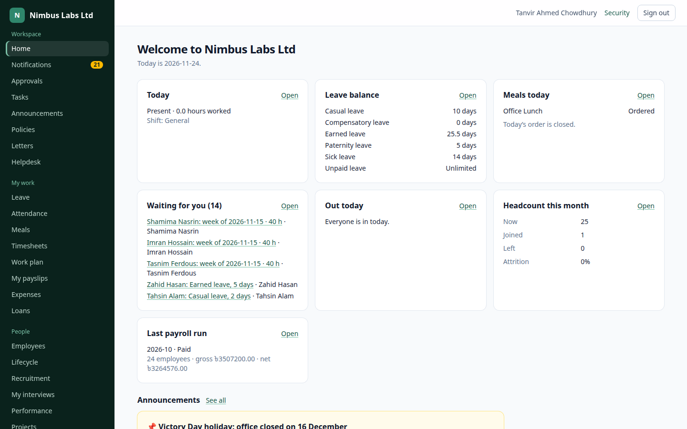
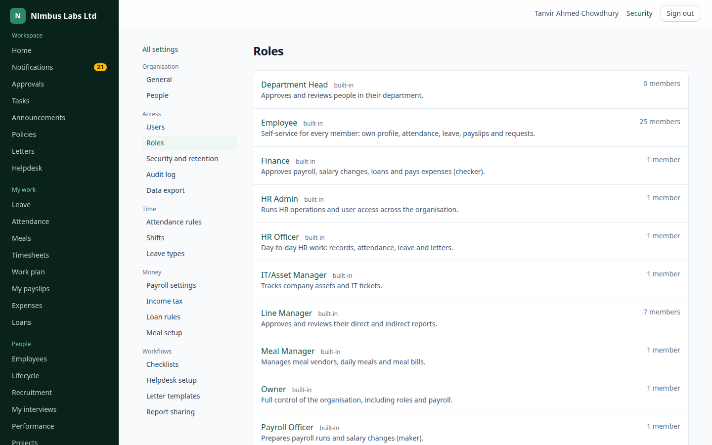

# HRMS Pro

Multi-tenant HR system for running a software company: people, leave, attendance, timesheets, payroll with Bangladesh
tax, loans, expenses, meal billing, recruitment, performance, helpdesk, letters, policies and shareable reports.

SvelteKit (Svelte 5) · TypeScript · Postgres 17 with row-level security · drizzle-orm · Redis + BullMQ · MinIO ·
Vitest · Playwright · Docker.

[](https://youtu.be/BGxO0nnjlsM)

<p align="center"><a href="https://youtu.be/BGxO0nnjlsM" target="_blank" rel="noopener">▶ Watch the 7-minute walkthrough on YouTube</a></p>

<p align="center"><a href="https://srabon444.github.io/htms-pro/"><b>System design</b></a>: architecture, data model, business requirements and functional spec</p>

## Screenshots

<table>
  <tr>
    <td width="50%"><br><sub>Dashboard scoped to the signed-in role</sub></td>
    <td width="50%"><br><sub>Employee directory with filters and CSV import and export</sub></td>
  </tr>
  <tr>
    <td><br><sub>Payroll run with tax, provident fund and bank sheets</sub></td>
    <td><br><sub>Recruitment pipeline from applied to hired</sub></td>
  </tr>
  <tr>
    <td><br><sub>Leave approval with the attached prescription</sub></td>
    <td><br><sub>Roles with permissions at own, team, department or company scope</sub></td>
  </tr>
</table>

## How it is built

- **Tenant isolation in the database.** Every tenant table has Postgres row-level security, so a missed filter in code
  still cannot leak another company's data.
- **Scoped permissions.** Each permission is granted at own, team, department or company scope, and every check runs
  on the server.
- **Files with access rules.** Attachments on 15+ record types (leave, resignations, candidates, offers, salary changes,
  projects, assets and more) live in MinIO and open only for people who may see the record.
- **Money in integer poisha.** Payroll, tax, loans and meal bills never touch floating point.
- **Background work.** Email, meal bills and an hourly job for leave accrual, attendance and exits run on BullMQ
  workers backed by Redis.
- **Audit trail.** Database triggers record every change, with sensitive fields masked.
- **Tested.** 690+ unit, integration and end-to-end tests run against real Postgres, Redis and MinIO.

## Run it locally

```bash
cp .env.example .env && npm ci && npm run infra:up && npm run db:migrate
SEED_PASSWORD=secret npm run db:seed && npm run dev   # and `npm run worker`
```

The seed creates the demo company at `/t/demo` with `owner@demo.local`, `hr@demo.local`, `manager@demo.local`,
`staff@demo.local`, `payroll@demo.local` and `finance@demo.local`, all using `SEED_PASSWORD`.

Running, configuring and operating it: [RUNBOOK.md](RUNBOOK.md).
